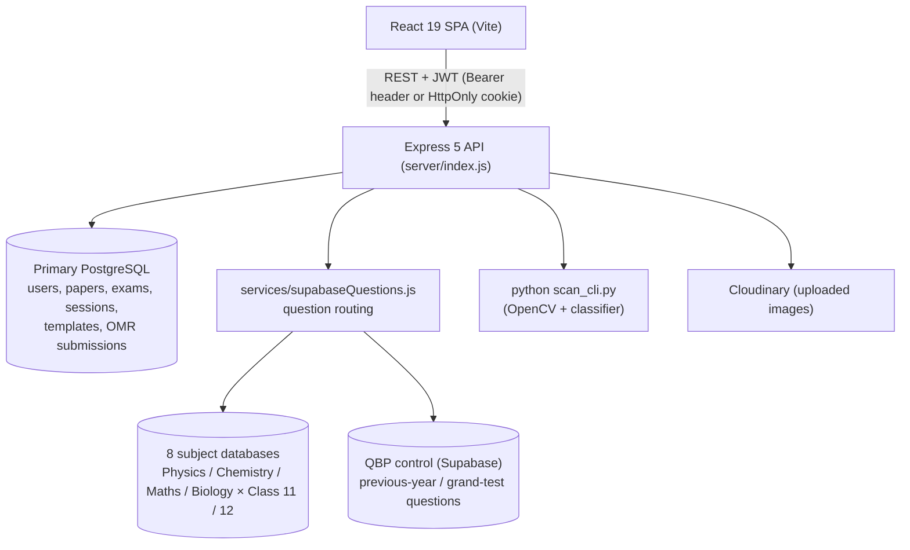

# Sapthagiri PU College — Examination Management Platform

Question-paper generation, answer keys, OMR evaluation and online (CBT) examinations for
Sapthagiri PU College, Davanagere, Karnataka.

This README describes what is in the repository today. It was rewritten from the code, not from the
previous README. Known defects and open decisions are tracked in
[docs/AUDIT_AND_CHANGELOG.md](docs/AUDIT_AND_CHANGELOG.md); read that before a production rollout.

## Contents

1. [What the system does](#1-what-the-system-does)
2. [Architecture](#2-architecture)
3. [Database topology](#3-database-topology)
4. [Tech stack](#4-tech-stack)
5. [Directory structure](#5-directory-structure)
6. [API reference](#6-api-reference)
7. [Environment variables](#7-environment-variables)
8. [Install and run](#8-install-and-run)
9. [Database setup and migrations](#9-database-setup-and-migrations)
10. [Tests](#10-tests)
11. [Deployment](#11-deployment)
12. [Security notes](#12-security-notes)
13. [Troubleshooting](#13-troubleshooting)
14. [Limitations](#14-limitations)

---

## 1. What the system does

| Module | Where | Notes |
|---|---|---|
| **Question paper wizard** | `client/src/pages/teacher/CommissionedExam.jsx` | 7 steps: exam pattern → chapters → per-chapter quotas → question types → difficulty → fetch → preview/save. Auto mode calls `POST /api/questions/chapter-distribution`; manual mode lets the teacher pick questions. The result screen shows requested vs delivered per chapter and says so when a quota could not be met. |
| **Question selection** | `server/services/questionSelector.js` | Pure function. Fills each chapter's quota only from that chapter, never uses a question twice, applies type allocations and difficulty targets, and reports every shortfall. Seedable (`seed`). |
| **A4 paper engine** | `client/src/components/A4PaperEngine.jsx`, `PaperRenderer.jsx`, `QuestionBlock.jsx` | One or two columns, adjustable margins, fonts, spacing, diagram size, watermark (on/off, opacity, size), custom starting question number. Printing uses the browser's print dialog (CSS `@media print`), so the PDF is whatever the browser produces from the preview. |
| **Answer key and solutions** | `A4AnswerKey.jsx`, `A4SolutionKey.jsx` | 15-column key grid, numeric or alphabetic keys, print, PDF (jsPDF) and Excel (`xlsx`) export, numbering from the paper's starting number. |
| **P/Q/R/S sets** | `client/src/utils/pqrsGenerator.js` | Seeded, section-aware shuffle of questions (Q, R, S) and options (R, S) with the correct answer recomputed. Questions whose options refer to each other ("Both 1 and 2", "All of the above") keep their option order. The seed is the paper id, so sets are only stable once a paper has been saved. |
| **Assignments** | `client/src/pages/teacher/AssignmentGenerator.jsx` | Class, chapters, question count, starting number, marks per question, submission date, instructions and student detail lines (name, class/section, register number). |
| **Paper export** | `server/services/wordExport.js`, `pdfPaperExport.js` | Word (`docx`) and server-side PDF (puppeteer) export of saved papers. |
| **OMR** | `server/omr_engine/` (Python), `server/routes/omr.js`, `server/services/omrEvaluator.js`, `pqrsKeys.js` | OpenCV preprocessing plus a bubble classifier (`models/bubble_classifier.keras` / `.onnx`). Node runs `scan_cli.py` per sheet, then grades against the key of the series the student sat (P/Q/R/S). Sheets with multiple marks, an unreadable series or roll number, or duplicate roll numbers are flagged for manual review. **No accuracy figure is claimed**: none has been measured on a labelled set of real sheets. |
| **Online CBT** | `client/src/pages/exam/`, `pages/lab/`, `server/routes/exams.js`, `lab.js`, `services/cbtScoring.js` | Lab terminal login, roll-number check against `public.students`, server-side timing, autosave, server-side scoring (+4/−1; CET/KCET +1/0), scorecard, leaderboard, full-screen and tab-switch detection that disqualifies a session. Browser-side monitoring can be bypassed; treat it as a deterrent. |
| **Admin** | `client/src/pages/admin/` | Faculty accounts, exam commissioning and merging, blueprints, templates, results and analytics, Grand Tests / previous-year papers (metadata only, see [limitations](#14-limitations)). |

## 2. Architecture



Front-end ↔ back-end: all calls go through `client/src/api.js` (axios, `withCredentials`, token from
`localStorage` sent as `Authorization: Bearer`). In production Vercel rewrites `/api/*` to the Render
service (`client/vercel.json`, `vercel.json`).

Question paper generation:

```
CommissionedExam.jsx ──POST /api/questions/chapter-distribution──► routes/questions.js
                                                                    └► supabaseQuestions.getQuestionsWithChapterQuotas
                                                                         ├ getQuestions()  (one random sample per chapter, class-strict)
                                                                         └ questionSelector.assembleByQuotas()  (pure, tested)
Step 7: PaperRenderer / A4AnswerKey / A4SolutionKey each derive the active P/Q/R/S set from the master paper
        with pqrsGenerator.generatePaperSet(master, set, startQNo)
OMR:    routes/omr.js ─► pqrsKeys.buildSeriesKey (server port of the generator; parity-tested against the client)
```

## 3. Database topology

* **Primary database** (`DATABASE_URL`, `server/config/postgres.js`): users, papers, exams, exam sessions,
  templates, blueprints, notifications, students, bridge keys, OMR submissions, question usage.
  Tables are created by `server/scripts/init_db.js`.
* **Eight subject databases** (`server/config/subjectDatabases.js`, env `DB_<SUBJECT>_<CLASS>_URL`):
  `phy_11 phy_12 chem_11 chem_12 math_11 math_12 bio_11 bio_12`. Each holds `public.questions`. Botany and
  Zoology are chapter subsets of Biology.
* **QBP control** (`DB_QBP_CONTROL_URL` / `_KEY`): a Supabase project holding previous-year and grand-test questions.
* MongoDB is no longer used (its code, models and dependency were removed; `MONGO_URI` is ignored).

Routing rules (`getPoolsForQuery`): a subject maps to its database(s); a class restricts to that class's
database; `Both` or no class queries both classes; an unknown subject returns **no** pools (it used to
query all databases). There are no cross-database transactions: a paper save writes only to the primary
database; question ids are read from the subject databases and are not copied.

## 4. Tech stack

| Layer | Technology (from `package.json`) |
|---|---|
| Front-end | React 19, Vite 8, React Router 7, Tailwind CSS 4, axios, KaTeX, jsPDF + jspdf-autotable, ExcelJS (`exceljs`, loaded only when exporting/importing a sheet), TanStack Query, react-hook-form, lucide-react |
| Back-end | Node.js, Express 5, `pg`, jsonwebtoken, bcryptjs, helmet, express-rate-limit, multer, Cloudinary, `docx`/`docxtemplater`, puppeteer, sanitize-html, `@supabase/supabase-js` |
| OMR | Python 3 (3.11 used when checking), OpenCV, NumPy, Keras/ONNX bubble classifier files in `omr_engine/models/` |
| Hosting (as configured) | Render (API, `render.yaml`), Vercel (SPA, `vercel.json`) |

## 5. Directory structure

Generated from the repository (images, OMR answer-key JSON and `node_modules` omitted).

```
SAPTHAGIRI_PU_COLLEGE/
├── api/index.js                 Vercel entry: re-exports server/index.js
├── client/
│   ├── src/
│   │   ├── App.jsx, api.js, main.jsx, index.css, App.css
│   │   ├── components/          A4AnswerKey, A4PaperEngine, A4SolutionKey, AdminDailyQuestionsWidget,
│   │   │                        ChapterBlueprintMatrix, ErrorBoundary, Loader, MathRenderer, PaperAnalysisModal,
│   │   │                        PaperQuestionEditorModals, PaperRenderer, QuestionBlock, QuestionImage, ResizableDiagram
│   │   ├── context/             AuthContext, LoadingContext
│   │   ├── pages/
│   │   │   ├── admin/           AdminDashboard, AdminLogin, AdminPaperPreview, AdminQuestionBank, AdminResults,
│   │   │   │                    BridgeApp, CreateTeacher, ExamBlueprints, ExamManagement, GrandTestList,
│   │   │   │                    PreviousYearPapers, SubjectDetails, UploadTemplate
│   │   │   ├── auth/            UnifiedLogin
│   │   │   ├── exam/            Disqualified, ExamEngine, ExamInstructions, Scorecard, StudentLabPortal
│   │   │   ├── lab/             LabExamList, LabLogin
│   │   │   └── teacher/         AddQuestion, AssignmentGenerator, CommissionedExam, SavedPapers,
│   │   │                        TeacherDashboard, TeacherLogin, TemplateCart, omr/TeacherOmr
│   │   └── utils/               exportWord, pqrsGenerator, questionValidator, sanitize
│   ├── tests/                   pqrsGenerator.test.mjs, pqrsServerParity.test.mjs
│   └── vercel.json, vite.config.js, eslint.config.js
├── server/
│   ├── index.js                 Express app, middleware, route mounting
│   ├── config/                  cloudinary, dbSsl, postgres (primary pool), subjectDatabases, supabase
│   ├── middleware/              auth, role, permissions, labIp, rateLimiter, loginThrottle, sessionToken, errorHandler
│   ├── routes/                  admin, auth, examBlueprints, exams, grandTests, lab, notifications, omr,
│   │                            papers, previousYearPapers, questions, templates
│   ├── services/
│   │   ├── accessRules.js       paper ownership, OMR paper access, image-proxy allow-list, CORS origin parsing
│   │   ├── cbtScoring.js        CBT answer comparison, marking, autosave merge, deadlines
│   │   ├── omrEvaluator.js      OMR sheet scoring and review flags
│   │   ├── pqrsKeys.js          server port of the P/Q/R/S generator
│   │   ├── questionSelector.js  chapter-quota question selection
│   │   ├── postgresStorage.js   primary-database access
│   │   ├── supabaseQuestions.js question routing across the subject databases
│   │   ├── pdfSafety.js         escaping and request filtering for the PDF generators
│   │   └── pdfPaperExport.js, pdfReport.js, wordExport.js
│   ├── omr_engine/              Python OMR pipeline (scanner.py, scan_cli.py, ml_omr/, omr_preprocess/,
│   │                            models/, templates/, scripts/ for training and export)
│   ├── migrations/              numbered SQL migrations (001 not applied)
│   ├── scripts/                 init_db.js, migrate.js, hash_plaintext_passwords.js
│   ├── tests/                   Jest tests (see §10)
│   └── utils/                   latexPreRenderer, mathToImage, sanitize
├── docs/AUDIT_AND_CHANGELOG.md  audit findings, change log, open issues
├── render.yaml, vercel.json     deployment configuration
└── package.json                 root scripts: dev, build, start, init:db
```

Not part of the application (ad-hoc debugging scripts, safe to delete once confirmed unneeded):
`find_limit.js`, `find_step5.js`, `search_special_types.js`, `test_type_queries.js`, `test_types_in_db.js`,
`test_types_real.js` at the root and `server/check_*.js`, `server/test_*.js`.

## 6. API reference

All routes are under `/api`. "Auth" means a valid JWT (Bearer header, `x-auth-token`, or the `auth_token`
cookie). Roles: `admin`, `teacher`, `lab`.

**Health:** `GET /` and `GET /api/health` (public).

**Authentication** (`/api/auth`)
`POST /login` public · `POST /logout` auth · `GET /me` auth

**Admin** (`/api/admin`, admin only)
`GET /` · `GET|POST /teachers` · `DELETE /teachers/:id` · `PUT /teachers/:id/password` · `PATCH /teachers/:id/omr-access` · `GET /questions-daily-stats`

**Questions** (`/api/questions`, admin/teacher)
`GET /` filters: `subject classes chapter concept type level usage source examType search limit page` · `POST /chapter-distribution` · `GET /meta` · `GET /daily-stats` · `GET /:id` · `POST /` · `POST /update/:id` · `DELETE /:id` · `POST /convert-numerical/:id` · `POST /:id/generate-variant` · `POST /bulk-import`

`POST /chapter-distribution` body: `{ subject, classes, examType, chapterQuotas: {chapter: n}, typeAllocations?, difficultyDistribution?, concepts?, excludeIds?, seed? }`
→ `{ questions, total, requestedTotal, complete, distributionReport, typeReport, difficultyReport, warnings[] }`

**Papers** (`/api/papers`)
`GET /proxy-image?url=` public, allow-listed hosts only · `POST /` · `GET /` (own papers; admin all) · `GET /:id` · `PUT /:id` · `PATCH /:id/section` · `DELETE /:id` (owner/admin) · `GET /admin/all`, `PUT /admin/:id/status` (admin) · `POST /export-word` · `GET /:id/export-word` · `GET /:id/export-pdf`. Teachers can only open papers they own or that belong to an exam they are assigned to.

**Templates** (`/api/templates`): `GET /` auth · `POST /`, `DELETE /:id` admin

**Exam blueprints** (`/api/exam-blueprints`): `GET /`, `GET /:id` auth · `POST /`, `PUT /:id`, `DELETE /:id` admin · `POST /:id/generate-paper` admin/teacher

**Grand tests** (`/api/grand-tests`): `GET /`, `GET /:id`, `POST /`, `POST /parse-text` admin/teacher · `PUT /:id`, `DELETE /:id` admin · `POST /:id/import`, `DELETE /:id/questions/:qid`, `POST /:id/questions/:oid/replace` return **501** (not available, see §14)

**Previous-year papers** (`/api/previous-year-papers`, admin): `GET /`, `GET /:id`, `POST /`, `PUT /:id`, `DELETE /:id` · `POST /:id/import` returns **501**

**Exams** (`/api/exams`)
Admin: `POST /commission` · `GET /commissioned` · `POST /merge` · `POST /from-grand-test` · `POST /from-paper` · `GET /` · `GET /admin/:id` · `PUT /:id/config` · `PUT /:id/toggle-online-visibility` · `DELETE /:id` · `GET /:id/results` · `GET /:id/analytics` · `POST /:id/bridge-key` · `GET /:id/export-word` · `GET /:id/download-all-reports`
Admin/teacher: `GET /:id` (includes answers) · `PUT /:id` · `GET /my-assignments` (auth)
Student/lab (no JWT, see §12): `GET /lab-active` · `GET /:id/take` · `POST /:id/start` · `POST /:id/session/save-progress` · `POST /:id/submit` · `POST /:id/malpractice` · `GET /:id/scorecard/:sessionId` · `GET /:id/pdf-report/:sessionId` · `GET /:id/leaderboard`
Bridge app: `GET /bridge/:key` (the key is the credential)

**Lab** (`/api/lab`): `POST /login`, `GET /exams`, `GET /student/:rollNumber` (restricted to `LAB_IP`)

**OMR** (`/api/omr`, admin or teacher with OMR access): `GET /papers` · `GET /papers/:id/key` · `POST /scan` (multipart `sheets`, `paperId`, `examType`, optional marks) · `GET /results/:paperId` · `GET /results/:paperId/student/:rollNumber` · `DELETE /submissions/:id`

**Notifications** (`/api/notifications`, auth): `GET /` · `PUT /:id/read` · `PUT /read-all`

## 7. Environment variables

Read by the server (`process.env.*`). Values are never committed; use `server/.env` locally and the hosting
dashboard in production. `server/.env.example` is the template.

| Variable | Required | Purpose |
|---|---|---|
| `JWT_SECRET` | yes | Signs and verifies tokens. Login and lab login return 503 if unset. |
| `ADMIN_PASSWORD` | yes | Password of the built-in admin account. Admin login returns 503 if unset. |
| `DATABASE_URL` | yes | Primary PostgreSQL. There is no built-in fallback: if it is unset the primary database is unavailable. |
| `DB_PHY_11_URL`, `DB_PHY_12_URL`, `DB_CHEM_11_URL`, `DB_CHEM_12_URL`, `DB_MATH_11_URL`, `DB_MATH_12_URL`, `DB_BIO_11_URL`, `DB_BIO_12_URL` | yes | Subject question databases. |
| `DB_QBP_CONTROL_URL`, `DB_QBP_CONTROL_KEY` | for previous-year / grand-test questions | QBP control Supabase project. Without the key those questions are unavailable. |
| `DB_SSL_CA` | recommended | PEM text (`\n` for line breaks) or file path of the database provider's CA certificate. Enables certificate verification; without it connections are encrypted but the server is not authenticated. |
| `SUPABASE_URL`, `SUPABASE_SECRET_KEY` | optional | Supabase client. |
| `LAB_ID`, `LAB_PASSWORD` | for CBT | Lab terminal credentials. Lab login returns 503 if unset. |
| `LAB_IP` | recommended | Comma-separated public IP(s) of the lab network. Unset means the lab endpoints accept any address. |
| `ALLOWED_ORIGINS` | recommended | Comma-separated front-end origins. Unset or `*` reflects every origin with credentials (any website could act as a logged-in user). |
| `IMAGE_PROXY_HOSTS` | optional | Extra hosts the image proxy may fetch (Cloudinary and `*.supabase.co` are built in). |
| `CLOUDINARY_CLOUD_NAME`, `CLOUDINARY_API_KEY`, `CLOUDINARY_API_SECRET` | optional | Image upload; falls back to local disk when missing. |
| `TRUST_PROXY_HOPS` | recommended | Number of proxies in front of the API. Browser → Vercel → Render is **2** (set in `render.yaml`). It decides which address is the client's (lab-network check, rate limits). |
| `DB_POOL_MAX`, `DB_POOL_IDLE_MS` | optional | Connection pool size / idle timeout for the primary database. |
| `PDF_MAX_PAGES` | optional | How many PDF pages may render at once (default 3). |
| `GEMINI_API_KEY` | optional | Grand-test text parsing and question variants. |
| `PYTHON_BIN` | optional | Python executable for OMR (`python` on Windows, `python3` elsewhere by default). |
| `OMR_REVIEW_GAP` | optional | An OMR answer whose best bubble beats the runner-up by less than this (default 0.15) is flagged for review. Not validated on real sheets. |
| `SEED_FACULTY_PASSWORD` | optional | Only for `npm run init:db`: password for starter faculty accounts (omit to skip them). |
| `PORT`, `NODE_ENV` | optional | |

Client: `VITE_API_URL` (`client/.env.production`).

## 8. Install and run

Prerequisites: Node.js 18 or newer (24 was used while auditing), Python 3.10+ with `opencv-python`, `numpy` and the classifier's runtime
(only for OMR), access to the PostgreSQL databases above.

```bash
npm --prefix server install
npm --prefix client install
cp server/.env.example server/.env      # then fill in the values
npm run dev                             # API on :5000 and Vite dev server together
```

Production build: `npm run build` (client → `client/dist`), `npm start` (API).

## 9. Database setup and migrations

`npm run init:db` runs `server/scripts/init_db.js`: it creates the primary-database tables with
`CREATE TABLE IF NOT EXISTS`, seeds the admin account from `ADMIN_PASSWORD` only if it does not exist, and never
changes an existing account.

Schema changes go in `server/migrations/NNN_name.sql` (only the part above the `-- ── DOWN` marker runs).
`node server/scripts/migrate.js` lists pending migrations without changing anything; `--apply` runs them, each in a
transaction, and records them in `public.schema_migrations`. **Migration 001** (Grand Test and previous-year
question storage), **002** (`users.omr_access`), **003** (one open exam session per student) and **004** (`omr_submissions`,
used by OMR scanning) are written but **not applied to production**. Back up first; the rollback SQL is at the bottom of each file.

`node server/scripts/hash_plaintext_passwords.js` reports user accounts with unhashed passwords (dry run; `--apply` hashes them).

`node server/scripts/question_bank_fix_plan.js --csv plan.csv` writes the proposed corrections (read-only), and
`node server/scripts/question_bank_apply_fixes.js --plan reviewed.csv [--apply]` applies a reviewed plan: dry run by
default, only `SET correct_option` items, only on rows unchanged since the plan, with the old values saved in a backup
table and `--rollback` to undo (take a database backup first). Reviewed on a throw-away database only.

`node server/scripts/question_bank_quality_report.js` is a **read-only** report of suspect rows in the eight subject question banks
(empty or duplicate options, bad `correct_option`, `[UNCLEAR]` placeholders, unbalanced math, duplicate questions). It changes nothing;
`--csv file.csv` writes one row per flagged question, `--db phy_12` limits it to one database.

## 10. Tests

```bash
npm --prefix server run test:unit   # 152 tests: question selection, CBT scoring, OMR evaluation, access rules, login and lockout, session tokens, rate limiter, CORS, math rendering, exam merge, Word export, download headers, bank quality rules
npm --prefix client test            # 29 tests: P/Q/R/S generator, answer key numbering, server/browser parity
npm --prefix server run test:e2e    # ~100 end-to-end checks against a throw-away in-memory PostgreSQL + the real server (needs the 8 read-only question DB URLs in server/.env)
npm --prefix client run build       # production build check
```

The OMR image engine itself has no automated accuracy test. `server/omr_engine/scripts/test_model.py` exists
but was not run or reviewed.

## 11. Deployment

* API: Render web service, `rootDir: server`, `node index.js` (`render.yaml`). Set every variable in §7 in
  the Render dashboard; do not keep secrets in `render.yaml`.
* SPA: Vercel, build `npm --prefix client run build`, output `client/dist`; `/api/*` and `/uploads/*` are
  rewritten to the Render service.
* OMR needs Python with OpenCV on the API host; the default Render Node runtime does not provide it.

## 12. Security notes

* Roles are enforced per route with `auth` + `checkRole`. Teachers can only access papers they own (or are
  assigned through an exam), and only their own OMR submissions.
* Student CBT endpoints: `/start` issues a signed token bound to one session and exam; `submit`, `save-progress`,
  `malpractice`, `scorecard`, `pdf-report` and `leaderboard` require it (header `x-session-token`). A roll number is
  still the only student identity, so set `LAB_IP` to accept `/start` only from the lab network.
* Login tokens are accepted only in the `Authorization` header or the HttpOnly cookie, never in a URL or body;
  admin downloads are made as authenticated requests.
* Failed logins are throttled (10 per account and address, 100 per address, per 15 minutes; in memory, per instance).
* `GET /api/exams/:id` returns answers and is limited to admin/teacher. `GET /api/exams/:id/take` strips answers.
  Scorecards are served only after submission.
* Passwords are bcrypt hashes; unhashed passwords are refused.
* No secret is in the source any more (`render.yaml` uses `sync: false`; `.env.example` has placeholders), **but
  every credential that was ever committed is still in git history and must be treated as exposed: rotate them and
  purge the history.** The two student enrolment PDFs are untracked but also remain in history.
* The server-side PDF generators escape their input, disable JavaScript and allow only data: URLs and allow-listed
  https images (`services/pdfSafety.js`).

## 13. Troubleshooting

| Symptom | Cause / fix |
|---|---|
| "Login is not configured on the server" (503) | `JWT_SECRET` / `ADMIN_PASSWORD` missing. |
| "Lab login is not configured" (503) | `LAB_ID`, `LAB_PASSWORD` or `JWT_SECRET` missing. |
| Lab terminal refused | `LAB_IP` set and the terminal's public IP is not listed (the 403 response shows the address seen). |
| The OMR screen says scanning is not available | The server has no Python or no OpenCV/ONNX libraries. `GET /api/omr/health` says which. On Render the build installs them into `server/omr_engine/pylibs` (see `render.yaml`); locally run `pip install -r server/omr_engine/requirements.txt`. |
| "NEET series detection is ambiguous" | The scanner could not read the series bubble; rescan a clearer image. |
| Fewer questions than requested | Read the summary on the preview screen: it lists each chapter's requested/delivered/available counts. |
| Empty question list for a subject | The subject must be Physics, Chemistry, Mathematics, Biology, Botany or Zoology (or PCM/PCB/PCMB). |
| `/api/health` answers 503 | The primary database cannot be reached (the response says `db: unreachable`). |
| PDF export fails with "Could not find Chrome" | Run `npm install` again in `server/`; Chrome is stored in `server/.cache/puppeteer` (`.puppeteerrc.cjs`). |
| `DATABASE_URL is not set` / a subject database is unavailable at start-up | The variable is missing: there are no built-in fallbacks. Set it (Render dashboard or `server/.env`). |
| Previous-year / grand-test questions missing | `DB_QBP_CONTROL_KEY` is not set. |
| 429 "Too many failed login attempts" | 10 wrong passwords for one account from one address; wait 15 minutes. |
| Exam screen shows "A valid exam session is required" | The session token is missing or expired; restart the exam from the lab portal. |

## 14. Limitations

* Grand Test and previous-year question import/replace/remove are unavailable (HTTP 501) until migration 001 is applied
  and the endpoints are written; the PostgreSQL tables hold only paper metadata.
* Grand Tests cannot be linked to a template (no column).
* Sets Q/R/S depend on the saved paper's id; unsaved papers use a temporary seed (the preview says so).
* Questions are edited, swapped and deleted on Set P only; the other sets are derived views.
* PDF output is produced by the browser from the on-screen preview; page breaks follow CSS rules and were
  not verified against a physical printer.
* OMR confidence scores are not exposed by the engine CLI, so only the review flags listed in §1 exist.
* No multi-subject PDF merge tool exists; merged exams are merged as question lists (`POST /api/exams/merge`), with marks
  following the exam type.
* The Word export converts LaTeX to Unicode text; it does not embed typeset equations.

Institution: Sapthagiri PU College, Davanagere, Karnataka.
