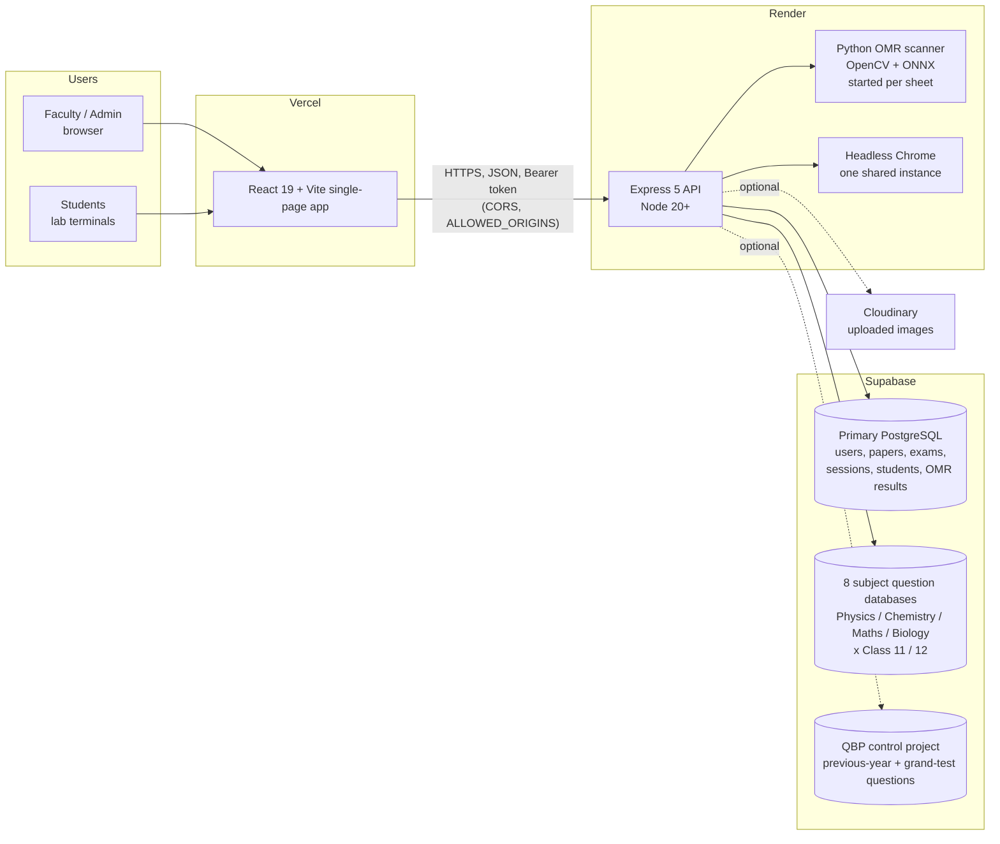
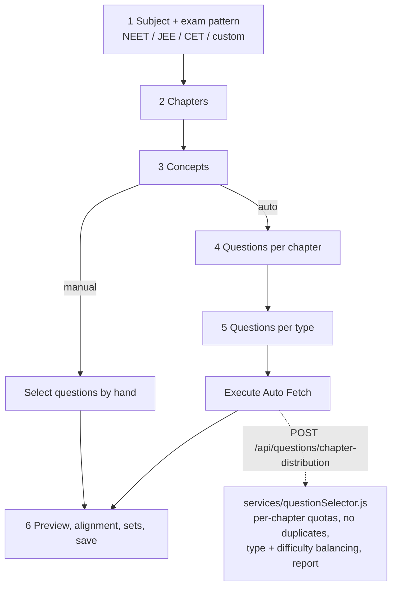
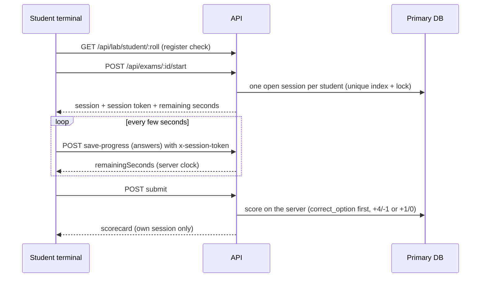

# Architecture

How the Sapthagiri PU College Examination Management system is put together, as it exists in the code today. Everything here
was read from the code or verified by running it; where something is a decision rather than a fact it says so.

## 1. The system at a glance



* The site is a static bundle hosted on Vercel. The bundle contains the API address (`VITE_API_URL`), so the browser calls
  Render **directly**; the `/api` rewrites in `vercel.json` are a fallback only. Consequence: one proxy (Render's load balancer)
  sits in front of the API, which is why `TRUST_PROXY_HOPS=1`.
* There is **one** process on Render: the Node API. The OMR scanner is a short-lived Python process per sheet; PDF output uses
  one shared headless Chrome inside the same container.
* MongoDB is no longer part of the system (removed in this audit).

## 2. Repository layout

```
client/                     React app (Vite)
  src/pages/admin/          admin screens (dashboard, results, exams, faculty, blueprints, templates, grand tests, ...)
  src/pages/teacher/        paper wizard, assignments, saved papers, question bank, OMR
  src/pages/exam/           student exam: portal, instructions, engine, scorecard
  src/pages/lab/            lab login and lab exam list
  src/components/           paper rendering: A4 engine, PaperRenderer, QuestionBlock, answer/solution keys, modals
    question/               one file per question type (MCQ, assertion-reason, match, statements, ...) + parsing/layout helpers
    paper-renderer/         header, cover page, settings panel, marks helpers
  src/utils/                PQRS generator, toast, Excel export/import, download helper, sanitising
server/
  index.js                  app, security middleware, route mounting, start-up
  config/                   primary pool, subject-database pools, TLS, Cloudinary, Supabase client
  middleware/               auth, role, lab network, rate limits, login throttle, session tokens, error handler
  routes/                   12 route files (auth, admin, questions, papers, exams, lab, omr, ...)
  services/                 question selection, CBT scoring, OMR evaluation, PQRS keys, PDF/Word export, access rules
  migrations/ scripts/      numbered SQL migrations, init/migrate/report/fix scripts
  omr_engine/               Python scanner (scan_cli.py), reference sheets, ONNX bubble classifier
  tests/                    unit tests; tests/e2e = end-to-end suite
docs/                       this file, the audit register, review findings, deployment readiness, data lists
```

## 3. Data architecture

| Store | Holds | Notes |
|---|---|---|
| Primary PostgreSQL (`DATABASE_URL`) | users (admin/faculty), papers, online exams, exam sessions, students (register), OMR submissions, templates, blueprints, notifications, bridge keys | Created by `scripts/init_db.js`; changes only through numbered migrations. |
| 8 subject databases (`DB_*_11/12_URL`) | `public.questions` for one subject and one class each | Read by everyone; written only by faculty question-bank tools. Class 11 questions never come from a class 12 database: routing is in `config/subjectDatabases.js` (`getPoolsForQuery`), and an unknown subject returns no database. |
| QBP control (Supabase client) | previous-year and grand-test question banks | Optional; needs `DB_QBP_CONTROL_KEY`. |
| Cloudinary | uploaded question and template images | Falls back to local disk when unset. |

A question row keeps its option text in `opt_a..opt_d` and the correct choice **letter** in `correct_option` (authoritative);
`answer` holds the text of the answer. Scoring always uses the letter first (`services/cbtScoring.js`).

Papers store question ids plus a metadata object; the P/Q/R/S seed lives in `metadata.pqrsSeed` so sets stay stable.

## 4. Question paper generation (the wizard)



* **Auto fetch** is decided on the server (`assembleByQuotas`): every chapter gets exactly its requested count where the bank has
  it, duplicates are removed, option-less questions are skipped, and a **generation report** (requested / delivered /
  available per chapter, type and difficulty) is shown, so a short paper is never silent. This fixed the original defect
  (30 questions from one chapter when 3 × 10 were requested).
* The wizard shows five steps for manual selection and six for automatic; the last step is always the preview.
* **Sets P/Q/R/S** are seeded, section-aware shuffles. The browser (`utils/pqrsGenerator.js`) and the server
  (`services/pqrsKeys.js`) must agree, and a test (`client/tests/pqrsServerParity.test.mjs`) enforces it. OMR grading
  uses the same server keys.
* **Answer key and solution** use a custom start number (start at 10 gives Q.10, Q.11 ...).
* Output: A4 preview (one/two column, watermark, diagrams), PDF (server-side Chrome, vector math), Word (`docx`).

## 5. Online exam (CBT) flow



Rules enforced by the server, not the browser: the clock (deadline plus a 2-minute grace), the lab network (`LAB_IP`),
one attempt per student (an admin can reset one), authoritative scoring, ownership of scorecards, and rate limits keyed per
exam session so a lab sharing one IP is not locked out. Tab switches are recorded; they do not prove cheating and the
system does not claim to prevent it.

## 6. OMR flow

`POST /api/omr/scan?async=true` stores the sheets, answers at once with a job id, and scans them one by one in the
background; the screen polls `GET /api/omr/scan/jobs/:id`. Each sheet runs `omr_engine/scan_cli.py`; the server grades the
reading against the paper's key for the detected series and **flags** for manual review: unreadable or unknown series,
multiple marks, uncertain or low-confidence bubbles, duplicate or inferred roll numbers. Results are stored in
`public.omr_submissions`. `GET /api/omr/health` reports whether Python and its libraries are present. Accuracy has **not**
been measured on real sheets and no figure is claimed.

## 7. Security model

* Secrets only from the environment; the code contains none. Passwords are bcrypt hashes; unhashed passwords are refused.
* Roles: admin, teacher (optionally with OMR access), student session token (separate from staff tokens, only valid for its
  own exam session). Ownership rules in `services/accessRules.js`.
* Login throttling per address and account; generic error message; a database outage answers 503 instead of "wrong password".
* CORS allow-list (`ALLOWED_ORIGINS`), Helmet headers on the API, security headers on the site (Vercel), rate limiting,
  parameterised SQL only, SSRF allow-list on the image proxy, PDF generator with scripts and unknown requests blocked,
  spreadsheet export protected against formula injection, uploads limited in size and count.
* Known limits: students are identified by roll number only; browser monitoring is a deterrent, not a guarantee.

## 8. Reliability design

* One shared, bounded PDF browser that is replaced if it dies; health check that tests the database (503 when down);
  graceful shutdown; keep-alive timeouts matched to the platform; process-level error handlers.
* All failures return JSON with a plain message; details go to the server log only.
* Autosave every few seconds with a local copy in the browser; reload resumes the exam; submit retries after a network error.
* Large lists are paged on the server (50 per page); long OMR batches run as background jobs.

## 9. What is still large or unfinished (honest list)

* `CommissionedExam.jsx` (about 2 400 lines) and the `DashboardHome` component in `AdminDashboard.jsx` (about 1 500 lines) are
  single components with a lot of shared state; splitting them safely needs a state-management refactor that was not attempted.
* The paper wizard, A4 engine and OMR screens are desktop-first and were checked mainly at desktop and tablet width.
* Grand-test and previous-year import endpoints return 501 until migration 001 is applied and the endpoints are written.
